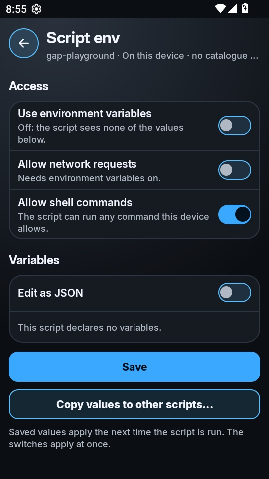
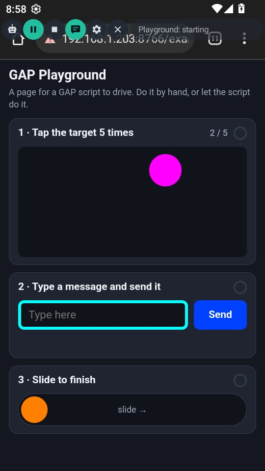
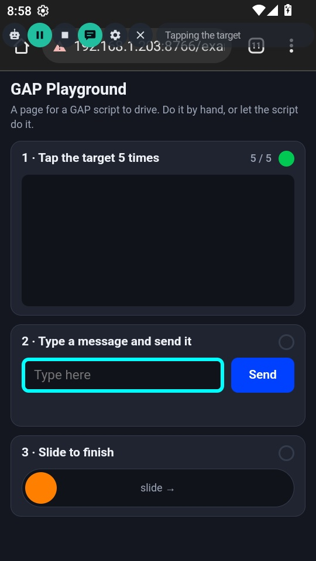
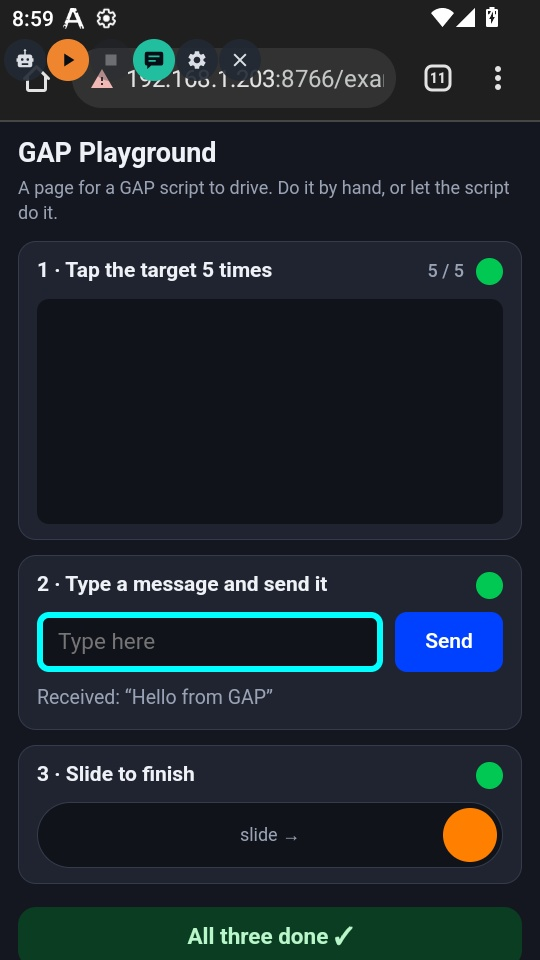

# GAP Playground

A complete GAP script and a web page for it to drive. Copy this folder, run it,
then change it into your own script.

The page, `web/playground.html`, has three tasks. The script does all three:

1. **Tap a target 5 times.** The target jumps somewhere new after every tap.
2. **Type a message and press Send.**
3. **Drag a slider to the end.**

It finds every control by its colour, so it works at any screen size, and it
checks its own work by counting the green badges the page shows for each
finished task.

## What's in the folder

| File | What it is |
|:--|:--|
| `index.js` | The script |
| `index.html` | Its settings page: the page address, whether to open it, the message to type |
| `web/playground.html` | The page the script drives. Also online at https://www.gapapp.app/examples/gap-playground/web/playground.html |
| `screenshots/` | A tested run, below. Not needed on the device |

## Run it

1. Copy the whole `gap-playground` folder to `Download/GeneralAutomationPlatform/scripts/`
   on the device:

   ```
   adb shell mkdir -p /sdcard/Download/GeneralAutomationPlatform/scripts
   adb push gap-playground /sdcard/Download/GeneralAutomationPlatform/scripts/
   ```

2. In GAP, open **Library → Local**. `gap-playground` is listed as on this device.

   

3. *Optional:* let the script open the page itself. Tap its card, tap
   **Settings**, and turn on **Allow shell commands**. Without it, open the page
   in a browser yourself before pressing Play.

   

4. Tap **▶** on the card. The floating bar appears. Press **▶ Play** on the bar.

| Running | Task 1 done | All done |
|:--:|:--:|:--:|
|  |  |  |

The log from that run (the page came from a local test server; its address is
shortened here):

```
[playground] opened http://<test server>/examples/gap-playground/web/playground.html
[playground] waiting for the page
[playground] tap 1 at 460,422
[playground] tap 2 at 165,422
[playground] tap 3 at 337,347
[playground] tap 4 at 375,435
[playground] tap 5 at 259,458
[playground] tasks done: 1 of 3
[playground] typed "Hello from GAP"
[playground] pressed Send
[playground] tasks done: 2 of 3
[playground] slid the knob to x=497
[playground] tasks done: 3 of 3
[playground] all three tasks done
```

Tested on GAP 4.5, Android 12 (x86_64 emulator, 540×960, 240 dpi), Chrome,
started from the Library card and the floating bar's Play button as above.
Since that run, the retry was changed to empty the text box before typing
again; that path was checked against a simulated page, not on a device.
The page was served from a local machine, which is why the address bar shows a
local address.

## How it works

| Step | Calls |
|:--|:--|
| Open the page | `execute('am start -a android.intent.action.VIEW -d "<url>"')` — the shell fallback, used only because no named call opens a URL. Returns `""` while shell commands are off, and the script carries on without it |
| Find a control | `getScreenshot()`, then `inRange()` for the control's colour and `findContours()` for the patches it makes, then `releaseImage()` |
| Tap the target | `tap(x, y, 400)` until the target is gone |
| Type and send | `tap()` on the text box, `typing(text)`, then `tap()` on Send |
| Drag the slider | `tapDown()`, twenty `moveTo(…, true)`, `tapUp()` |
| Check its work | Count the green badges; retry a task once if it did not register |
| Tell the user | `console.log()` for the log, `showBanner()` for the strip beside the bar |

Two lessons from testing are built in:

- **A tap can go missing.** The first version counted its own taps and stopped
  at 4 of 5. GAP also holds a script's touches back while a finger is on its bar
  (the log says *input held for the user*). So the script taps until the page
  says the task is done, and retries a task once if it didn't register,
  emptying the text box first so the message isn't typed twice.
- **Look again after acting.** Focusing a text box can bring up a keyboard and
  move things, so the script finds Send *after* typing, not before.

## Make it yours

- Point it at a different page with the **Page address** setting.
- Swap colour finding for picture finding (`findImage`) to work with apps you
  don't control — the [Quick start](https://www.gapapp.app/quickstart.html)
  shows how.
- Every call is in the [API reference](https://www.gapapp.app/api.html).
