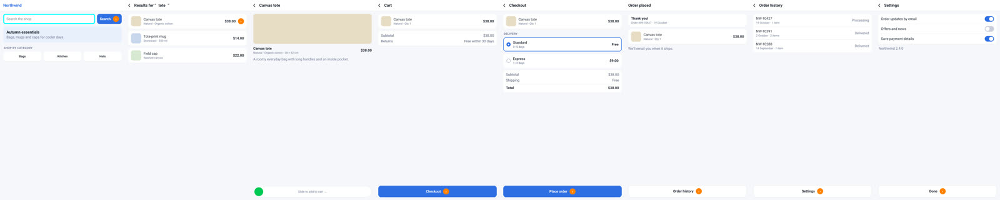
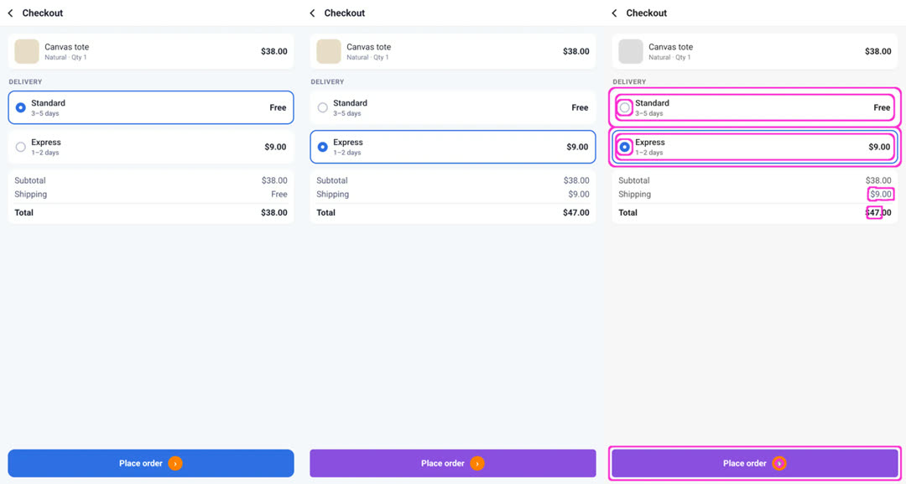
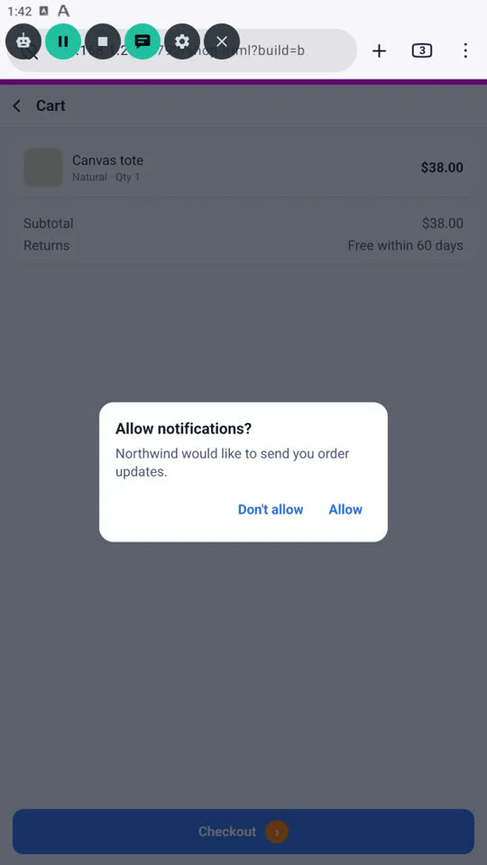
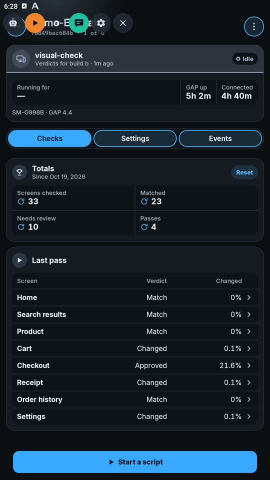
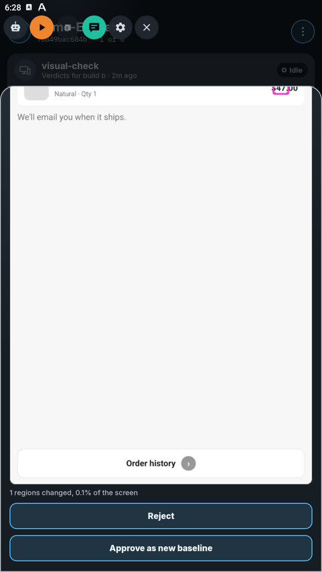
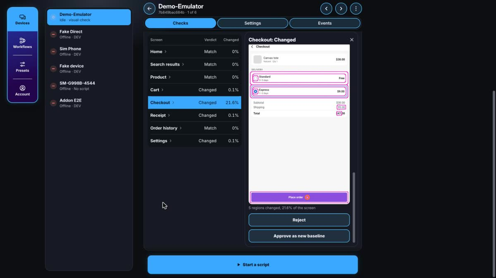

# Visual check

A GAP script that tests a web page visually: it walks through every screen of
a small shop, compares each one with an approved picture of it (its
**baseline**) and reports which screens changed. Copy this folder, run it, then
point it at your own app.

Tested on a device: the run below, screenshots included. Not yet on the
public site: the shop's online address works once the site is released.

The shop, `web/shop.html`, has eight screens: Home, Search results, Product,
Cart, Checkout, Receipt, Order history and Settings. It comes in two builds:

- `shop.html?build=a`, the baseline.
- `shop.html?build=b`, a new build: Checkout picks Express delivery, so
  shipping and the total change and the button is a new colour; Cart,
  Receipt and Settings change a few words; and Cart opens an "Allow
  notifications?" dialog the script has never seen.

Getting through the shop takes a tap, typing (the search box) and a drag (the
"slide to add" slider), like the [playground](../gap-playground/).

## What's in the folder

| File | What it is |
|:--|:--|
| `index.js` | The script: the walk and the comparison, then the GAP Companion layer |
| `index.html` | Its settings page: build, allowed change, screens, passes, page address |
| `web/shop.html` | The shop it walks. Also online at https://www.gapapp.app/examples/visual-check/web/shop.html |
| `screenshots/` | The tested run, below. Not needed on the device |

## Run it

1. Copy the whole `visual-check` folder to
   `Download/GeneralAutomationPlatform/scripts/` on the device:

   ```
   adb shell mkdir -p /sdcard/Download/GeneralAutomationPlatform/scripts
   adb push visual-check /sdcard/Download/GeneralAutomationPlatform/scripts/
   ```

2. In GAP, open **Library → Local** and tap ▶ on `visual-check`.
3. *Optional:* turn on **Allow shell commands** for it (its card → Settings),
   so it opens the shop itself. Without it, open the shop in a browser first.
4. Pick **Build A** and press **▶ Play**. The first pass saves every screen as
   its baseline.
5. Pick **Build B** and play again. Checkout is flagged; the dialog on Cart
   is closed with Back (or, with GAP Companion, by you from your phone).

The baselines from the tested run, one per screen, cropped below the shop's
magenta strip:



Build B, Checkout: the baseline, this run's picture, and the difference
(everything grey, what changed in colour with a pink outline):



The log of that run, build A then build B (the page came from a local test
server; its address is shortened here):

```
[visual-check] opened http://<test server>/shop.html?build=a&t=1792417096663
[visual-check] build a, threshold 0.02%
[visual-check] Home: New baseline
[visual-check] Home did not move on, trying again
[visual-check] Search results: New baseline
[visual-check] Product: New baseline
[visual-check] Cart: New baseline
[visual-check] Checkout: New baseline
[visual-check] Receipt: New baseline
[visual-check] Order history: New baseline
[visual-check] Settings: New baseline
[visual-check] pass 1: All 8 matched
[visual-check] opened http://<test server>/shop.html?build=b&t=1792417150013
[visual-check] build b, threshold 0.02%
[visual-check] Home: Match
[visual-check] Search results: Match
[visual-check] Product: Match
[visual-check] Cart did not show: an unfamiliar screen
[visual-check] Cart: Changed (0.06%, 1 regions)
[visual-check] Checkout: Changed (21.6%, 5 regions)
[visual-check] Receipt: Changed (0.09%, 1 regions)
[visual-check] Order history: Match
[visual-check] Settings: Changed (0.06%, 1 regions)
[visual-check] pass 1: 4 screens changed
```

Tested on GAP 4.4, a BlueStacks emulator (Android 13, 1080×1920, 320 dpi)
with Firefox Beta 159, started from GAP Companion. In that run the dialog
was answered from the companion (below); a second run with no answer
pressed Back after 10 minutes and finished the same way. On this emulator
Chrome showed blank pages (its renderer launcher crashes there) and Firefox
needed its software renderer (`gfx.webrender.software`); on a phone the
default browser should do.

The pictures are in this device's own folder, `getDevicePath()` +
`/visual-check/<screen>/`: `baseline.png`, `current.png` and, for a changed
screen, `diff.png` (the screen in grey, what changed in colour with a pink
outline). Delete a screen's `baseline.png` to take a new one.

## How it works

| Step | Calls |
|:--|:--|
| Open the shop | `execute('am start -a android.intent.action.VIEW -d "<url>"')`, only because no named call opens a URL |
| Find a control | `getScreenshot()`, `inRange()` for its colour, `findContours()` for the patch. The shop gives each control a colour nothing else uses |
| Move on | `tap()`; `typing()` into the search box; `tapDown()`, `moveTo()`, `tapUp()` for the slider |
| Capture | Wait until two screenshots in a row are the same, then `cropImage()` below the magenta strip the shop draws at its top, so the browser's own bar is never compared |
| Compare | `absDiff()` with the baseline, `bgrToGray()`, `threshold()` (a channel moved by more than 32), `dilate()` so nearby changes join, `findContours()` for the regions. A screen matches while the regions cover less than the allowed change (0.02 % by default: a changed price is about 0.1 % of a phone screen) |
| Save | `saveImage()`; the difference picture is three masked layers (`cloneWithMask()`) added together with `absDiff()` |
| Report | `console.log()`, `showBanner()`, and `emitEvent()`: `check.screen` per screen, `check.results` and `check.run` per pass |
| Know where it is | The shop draws its magenta strip n/8 of the width on screen n, so the script reads which screen shows. The build B dialog dims the strip: no screen, so an unfamiliar one |
| An unfamiliar screen | When the screen it expects never shows, it presses Back, which closes the shop's dialog |

What testing taught, now built in:

- **A step can go missing.** The first search of a run sometimes didn't
  register. If the previous screen is still showing, the script does that
  step once more (emptying the search box first, so the word isn't typed
  twice); only a screen it can't name is unfamiliar.
- **The same control on two screens fools you.** Most screens move on with
  the same orange disc, so seeing it proved nothing: a missed search let the
  script take Home for the search results. Hence the strip that says which
  screen it is.
- **A page that just loaded can hold still half drawn.** Its boxes were
  there and its text not yet, for long enough to look settled. The first
  screen of a pass gets 1.5 s more.
- **A small change is a small area.** A changed price is about 0.1 % of the
  screen, so the default allowed change is 0.02 %: unchanged screens measured
  exactly 0 in every run.

## Watch it from your phone

With the script signed and the device linked to
[GAP Companion](https://www.gapapp.app/companion/), the same run also:

| Needs direction | Checks tab | A screen's detail |
|:--:|:--:|:--:|
|  |  |  |




- shows a **Checks** tab: every screen's verdict from the last pass; tap one
  to see its baseline, current picture and difference, with **Approve** (the
  current picture becomes the baseline) and **Reject**;
- puts "5 of 8 screens" on the device's card;
- lets you change the build, allowed change and screens from the phone, and
  save them as a preset for many devices;
- pushes "3 screens changed" when a pass ends, and an alert when a screen
  can't be reached;
- **asks you what to tap** on a screen it doesn't know (the dialog in build
  B): your phone shows the screen, you tap "Don't allow", press ▶‖, then
  Continue. Without an answer in 10 minutes it presses Back itself.

That layer is the `gap*` globals at the bottom of `index.js`. They do nothing
without GAP Companion, and they are a working example of its script contract.

## Make it yours

- Point **Page address** at your own page and give its controls colours of
  their own, or swap colour finding for picture finding (`findImage`) to walk
  an app you don't control.
- Change `SCREENS` in `index.js`: each entry says what proves the screen is
  there (`look`, with the strip's screen number) and how to move on (`next`).
- Every call is in the [API reference](https://www.gapapp.app/api.html).
